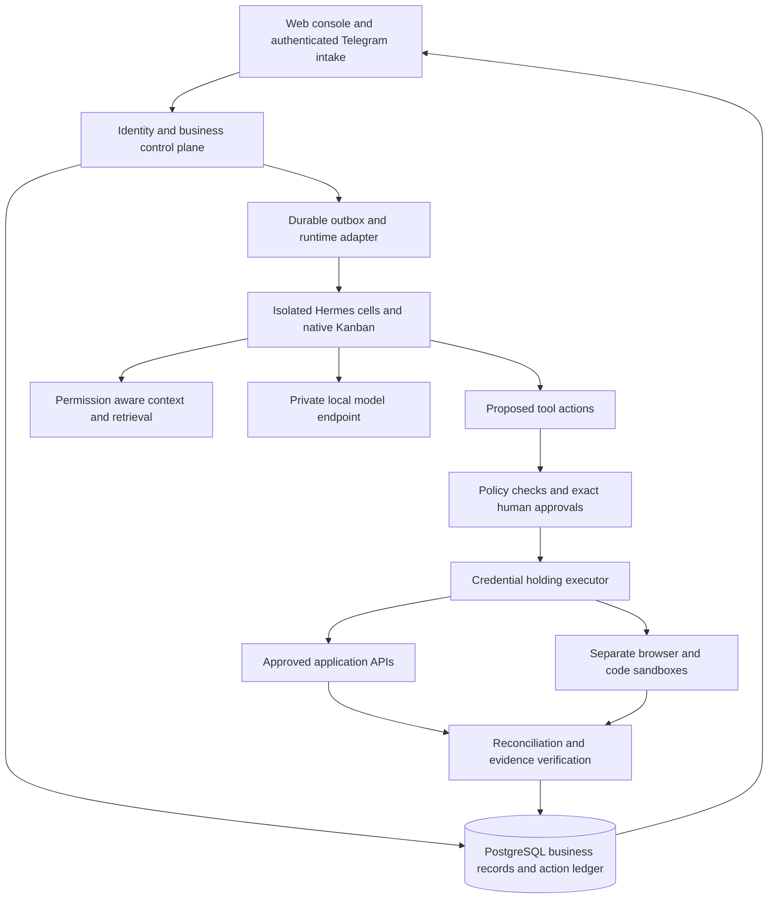

# PraxisForge AI production build plan

Date: 15 October 2026. Status: ten-phase roadmap with the execution amendment below. Individual phase exit conditions remain open until their complete evidence is recorded.

Build a self-hosted business operations platform powered by Nous Research's Hermes Agent. The first package serves agencies: meeting notes → commitments → permitted client context → follow-up drafts → exact human approval → messages and CRM changes → verification receipts. The product interface must show completed, failed, blocked, cancelled, and uncertain outcomes separately.

Deliver exactly ten incremental releases. Every phase develops frontend, backend, agent/data work, infrastructure, and verification together, then deploys a working increment. Security, evaluation, and recovery begin in the first phase and deepen throughout.

## Current execution amendment — 15 October 2026

The owner subsequently authorized frontend implementation, deployment and the main core. The professional20-route website and a bounded trusted-owner operations core are deployed on the existing server. The website passed its final local/public browser, accessibility, source and deployment gates. The corrected core completed three real Hermes roles after worker-interruption recovery, then exact approval and a verified internal receipt. Production encrypted off-host backup and isolated restore passed. The original CPU timeout/failure remains recorded; the successful CPU workflow required about14.5minutes of model work. The mobile provenance-wrapping correction and current evidence-based status pages are live and verified. [README.md](README.md) records the implemented scope and final verification status.

This first release uses PostgreSQL as the sole durable workflow owner and invokes pinned Hermes AIAgent roles as worker activities. It does not run a competing native Kanban scheduler. Opaque owner sessions serve the initial trusted-operator deployment; enterprise identity/Keycloak, independently isolated customer workers and broader connectors remain planned. Text knowledge and internal approved drafts/commitments precede vector/OCR retrieval and external message delivery.

No AWS, GCP or Azure deployment has been claimed or provisioned by this core release. Their verified-free eligibility and real deployment evidence remain explicit open milestones. Consequently, the bounded release does not mark all ten phases complete, nor does it satisfy Phase 1's Azure milestone by substitution. Future phases retain their parallel lanes, deployed increments and complete exit gates below.

## Cost and deployment boundaries

The target is **$0 additional cloud and API charges**, using free software, the existing server, and verified ongoing free allowances. The existing server, Internet access, electricity, and development effort are existing resources, not evidence that the total operating cost is zero. The owner has AWS, GCP, and Azure accounts and reports that free credits have been consumed. Assume no trial credits remain.

An account existing does not establish that its free grants remain available. Before each cloud deployment, verify subscription status, region, aggregate account usage, every supporting service, and the current pricing terms. Budget alerts do not enforce a hard billing cap. Google explicitly says budgets do not automatically cap spending; Azure spending limits are unavailable on pay-as-you-go subscriptions. [Google budgets](https://docs.cloud.google.com/billing/docs/how-to/budgets), [Azure spending limits](https://learn.microsoft.com/en-us/azure/cost-management-billing/manage/spending-limit).

| Location | Planned role | Free allowance and limitation | Release introduction |
| --- | --- | --- | --- |
| Existing server | Business UI/API, PostgreSQL, scoped evidence, Hermes cells, local models, monitoring | Reuse current capacity; no server upgrade. Fresh resource measurements decide deployment limits. | Phase 1, expanded every phase |
| AWS Lambda | Private test receipt and approval-contract verification harness; portable deterministic function, no inference | Published event-function grant: 1 million requests and 400,000 GB-seconds/month. Supporting logs, storage, network and other account consumption are separate. Do not rely on new-account credits. | Phase 3; repeated in 5, 7, 8 and 10 |
| GCP Cloud Run | Authenticated test document/contract validator and container portability checks | Request-based free allowance: 2 million requests, 180,000 vCPU-seconds and 360,000 GiB-seconds/month, with regional pricing conditions. Billing account required; registry, builds, networking and logs need their own checks. | Phase 4; repeated in 7, 8 and 10 |
| Azure Static Web Apps Free | Personal/documentation documentation, test status and downloadable redacted evaluation reports | Free tier includes 100 GB bandwidth/subscription and 0.5 GB storage, with 0.25 GB/app deployment size. No SLA; intended for hobby/personal use. Keep the business console on the server. | Phase 1; refreshed every phase |
| Existing owner PC or other already-owned storage | Encrypted off-server backups and restore destination | Requires sufficient disk, an available transfer window, protected keys and a tested restore. Cloud free storage is not assumed. | Phase 2, tested thereafter |

Sources: [AWS Lambda pricing](https://aws.amazon.com/lambda/pricing/), [Cloud Run pricing](https://cloud.google.com/run/pricing), [GCP Free Tier conditions](https://docs.cloud.google.com/free/docs/free-cloud-features), [Azure Static Web Apps pricing](https://azure.microsoft.com/en-us/pricing/details/app-service/static/).

AWS's new Free plan closes after six months or credit exhaustion; it is unsuitable as an indefinite production foundation. A GCP trial also stops without an upgrade when its credit/time ends. Do not create replacement accounts, upgrade plans, remove spending limits, or activate paid services to satisfy this plan. [AWS Free Tier](https://aws.amazon.com/free/), [GCP trial lifecycle](https://docs.cloud.google.com/free/docs/free-cloud-features).

**Cloud completion rule:** all three providers must eventually have real deployment and test evidence. A local emulator is useful development evidence and does not count as an AWS/GCP/Azure deployment. If an existing account cannot support a verified free deployment, mark that provider milestone blocked; continue the core release on the existing server. Do not quietly replace the missing cloud milestone or claim completion. An enduring guarantee of zero charges on a billable account is outside what quota monitoring can establish.

For each cloud profile, use a dedicated project/resource boundary and the minimum supported permissions. Before applying infrastructure, use platform-native inventory and cross-check billing: AWS Resource Explorer, GCP Cloud Asset Inventory, and Azure Resource Graph. Record inventory coverage gaps instead of assuming every region/account was searched. Keep state and account identifiers private.

Keep cloud work authenticated and test. Proposed application limits are 100 signed invocations/day, 100 KiB input, 5-second execution timeout, one concurrent worker, and 10 MiB application output/day; make these centrally configurable. Cloud Run starts with minimum instances zero and maximum instances one. Use account-wide consumption to determine whether even these limits are safe. These application limits reduce exposure and are not provider billing caps. Audit function logs, image storage, builds, retries and egress before enabling each profile. Use no managed databases, NAT gateways, load balancers, provisioned concurrency, paid AI APIs, GPUs, SMS, or premium monitoring.

## Architecture and ownership

| Component | Starting decision | Ownership and growth rule |
| --- | --- | --- |
| Frontend | Next.js and TypeScript, self-hosted | One operations UI; static export only for the separate Azure documentation/docs site. Accessibility and error states are first-class work. |
| Business API | FastAPI, typed request/response schemas, migrations | Owns users, workspaces, permissions, connection identities, action manifests, approvals, receipts and product events. |
| Database and retrieval | PostgreSQL, full-text search, pgvector | Start with lexical retrieval; add local embeddings and reranking when measured. Business facts and external submission state stay transactional. |
| Hermes runtime | One pinned, tested revision behind a compatibility adapter | Reuse native Kanban, profiles, memory, skills, scheduling and MCP. Contract-test the documented surfaces; do not assume a stable hosted API or direct Python imports. |
| Task ownership | Hermes Kanban owns native execution lifecycle; PostgreSQL owns business contracts and evidence | Outbox records bridge the two with idempotent delivery and reconciliation. They do not introduce another general workflow scheduler. One scheduler owns each recurring workflow. |
| Identity | Self-hosted Keycloak through OIDC, subject to capacity test | Enforce issuer, audience, resource authorization, session expiry, logout/revocation and privileged-user MFA. No bespoke password system. |
| Models | A small license-compatible quantized model behind llama.cpp or a measured equivalent | Model ID, endpoint, context size and concurrency come from central configuration. No silent remote fallback, paid provider, or assumed GPU. |
| Evidence | Tenant-scoped private filesystem adapter first; object-storage interface | Authorization on every download. Object-store implementation follows measured need; no public buckets or raw host-path access. |
| CRM | Self-hosted Twenty, if its current license, API and resource footprint pass the Phase 1 spike | Isolated fixture deployment first; no SaaS subscription required. Reject the dependency if its supported free self-hosted features cannot meet the contract. |
| Observability | OpenTelemetry instrumentation, PostgreSQL run evidence, lightweight metrics dashboards | Add Prometheus/Grafana only within the measured resource envelope. One primary evidence/evaluation store; no overlapping paid tracing products. |
| Deployment | Docker Compose and the existing reverse proxy | Versioned releases, pinned images, loopback-only web ingress, project-private networks and tested rollback. No Kubernetes requirement. |

These choices use documented self-hosting surfaces: [Next.js deployment](https://nextjs.org/docs/app/getting-started/deploying), [FastAPI deployment](https://fastapi.tiangolo.com/deployment/), [pgvector](https://github.com/pgvector/pgvector), [llama.cpp](https://github.com/ggml-org/llama.cpp), [Keycloak guides](https://www.keycloak.org/guides), [Twenty self-hosting](https://docs.twenty.com/developers/self-host/capabilities/docker-compose).

Hermes Kanban namespaces and profiles must not be treated as customer security boundaries. Give each independent client a separate OS-enforced execution cell, data mounts, credentials, network policy and Hermes state. Board separation is useful coordination, not protection against arbitrary code running under the same host identity. Avoid simultaneous memory writers in one agent home. [Hermes Kanban](https://hermes-agent.nousresearch.com/docs/user-guide/features/kanban), [Hermes memory](https://hermes-agent.nousresearch.com/docs/user-guide/features/memory).

The shared server is recorded as 8 vCPU and 24 GB RAM; that is historical capacity, not current available capacity. Phase 1 must measure existing workloads, CPU architecture, storage, memory, GPU availability, model latency and isolation support. Start with one inference request and one heavy browser/OCR job at a time. Define reservations and leave headroom for other projects; refuse a release that exceeds its approved envelope. Three agent roles do not require three simultaneously loaded models. Independent hostile-code customers need a stronger boundary or a reduced supported scope; do not label basic shared-kernel containers as protection against every host threat.

## How parallel work joins into a release

Each phase has five lanes: frontend, backend, agents/data, infrastructure/deployment, and verification/security. These are workstreams; one developer can interleave them. Actual concurrency requires available contributors and does not reduce integration work to zero.

Start each phase by freezing a small acceptance contract and shared schemas. Backend owns OpenAPI and state transitions; frontend can use contract fixtures while runtime and infrastructure work proceed. Assign file ownership or isolated worktrees to concurrent contributors. Integrate early against the real API, resolve schema changes together, and run one release gate before promotion. Do not let frontend mocks become evidence of backend functionality.

Every phase ends with this same release procedure:

1. Record criteria and configuration inventory before implementation; keep secret values only in the ignored recovery register/approved secret store. Typed settings own deployment/provider values, safe examples document variables, and maintained prompts/content live in validated data files.
2. Run tracked automated tests, type checks, lint, Bandit/Gitleaks/Semgrep, dependency and license checks, builds, and Compose validation. Verify new packages against real registries. Add configuration/secret regression checks. Report a missing gate as missing.
3. Obtain a fresh-context review of the diff and criteria. Correct findings; preserve manual scripts in the ignored personal-test folder. Update the private dossier and record escaped defects.
4. Snapshot relevant live files, compare with local, reconcile drift locally, build locally where feasible, and deploy an immutable release to private staging. Use the shared infrastructure's exact ownership and proxy conventions; reserve a free port only after live inventory. Do not edit shared host configuration wholesale.
5. Exercise the phase's real UI/API/worker flow, migrations, persistent data, external-port exposure and rollback. Promote only the supported scope; maintain the previous release and use forward-compatible migrations.
6. Verify local/live SHA-256 parity for deployed files, image digests and effective deployment configuration. Record separate treatment of runtime-generated state and protected secrets. Refresh the Azure test docs release when eligible, and save provider-specific evidence for introduced cloud profiles.

No phase requires deploying all heavy services twice on the shared host. Use short-lived isolated staging and controlled promotion within measured capacity. Release evidence includes source revision, artifact digest, criteria results, reviewer verdict, migration version, runtime/model/prompt/skill versions, sanitized flow receipts, rollback result and actual cloud consumption.

## Phase 1 Foundation and a deployable product shell

**Result:** an owner-only, authenticated-at-the-edge or deny-by-default product shell, with a real API health/capability endpoint and a verified deployment pipeline. No public task execution or real customer data.

| Parallel lane | Work in this phase |
| --- | --- |
| Frontend | Establish navigation, task inbox, run detail skeleton, connector/approval placeholders, responsive layout, keyboard navigation and clear unavailable states. |
| Backend | Create typed settings, API contracts, structured errors, health/readiness, request IDs and an initial migration. Inventory every changeable value before feature code. |
| Agents and data | Pin a Hermes revision; spike structured task submission/status/artifact extraction and model tool calling. Compare local model candidates on a small declared smoke set; verify licenses. Freeze agent roles: coordinator, knowledge researcher, operations drafter. |
| Infrastructure and deployment | Read-only native cloud/billing inventory; inspect server capacity and ownership registry; build pinned images and private Compose staging. Establish encrypted provisional backup and artifact manifests. Prepare Azure Static Web Apps Free docs profile if the existing subscription permits it. |
| Verification and security | Write threat model and scope boundaries, seed test fixtures, enable all code gates and configuration regression tests, validate dependencies, exercise install/start/stop and perform a fresh-context review. |

**Join contract:** versioned health/capabilities schema, selected runtime surface, tenant/run identifiers, dependency locks and resource envelope. Store decisions as architecture records.

**Deploy:** release P01 on the existing server in private release; deploy the separate personal/documentation build to Azure Free when eligibility passes. Deploy no full identity/agent service until its deny-by-default configuration is tested.

**Exit evidence:** clean-machine local bootstrap, real UI→API request, reproducible image, no exposed internal ports, rollback to the release baseline, Hermes adapter smoke result and measured model latency/RAM. If no free local model meets tool/quality requirements, record that blocker and retain a deterministic test provider only for development; do not claim an AI workflow is proven.

**Rollback:** remove the new application route/release only, preserve shared services and data. Unverified Azure eligibility leaves its milestone visibly blocked.

## Phase 2 Identity and enforced workspace boundaries

**Result:** two test client workspaces with authenticated users and real resource-level isolation, plus a tested backup before meaningful data is stored.

| Parallel lane | Work in this phase |
| --- | --- |
| Frontend | Implement sign-in/out, workspace switching, invitations, role management, session expiry and administrator MFA/recovery flows. Show access-denied states without revealing another client's metadata. |
| Backend | Integrate OIDC; implement owner/operator/approver/auditor roles, invitation expiry, revocation and per-resource checks. Use PostgreSQL row policies plus application checks; runtime DB roles cannot bypass tenant policies. |
| Agents and data | Separate worker identities, profiles/homes, mounts, evidence paths, cache keys and retrieval namespaces. Signed workspace context must come from the authenticated control plane, not request text. |
| Infrastructure and deployment | Deploy the measured identity service, per-workspace private volumes/networks and scoped secret mounts. Encrypt backup exports to an existing off-server destination; protect and separately escrow recovery keys. |
| Verification and security | Test identifier swapping, forged tenant headers, stale roles, object downloads, cache collisions, session revocation, CSRF/CORS, malicious invitation links and backup restoration. Include worker attempts to access another cell. |

**Join contract:** user/session/workspace claims, role matrix, authorized storage adapter and worker capability identity.

**Deploy:** P02 identity and isolated test workspaces to private staging and then the supported owner release; update Azure documentation with test boundary examples.

**Exit evidence:** A cannot read B through APIs, storage, caches or worker mounts; revoked roles lose access; MFA recovery works without bypass; an encrypted snapshot restores database and evidence into an isolated environment. Record what container isolation does and does not protect.

**Rollback:** disable new workspace admission, revoke release sessions, restore application compatibility; do not restore an old identity database over active credentials without reconciliation.

## Phase 3 Durable Hermes execution and accountable batches

**Result:** the three specialists complete a test agency workflow with persistent task records and crash recovery.

| Parallel lane | Work in this phase |
| --- | --- |
| Frontend | Connect the task inbox, dependencies, timeline, batch progress, cancel/retry controls, deadlines and blocked/unknown outcomes to the live API. |
| Backend | Store typed business task contracts, item ledgers, dispatch outbox, run mappings and completion evidence. Add cancellation propagation, delivery leases/fencing, bounded retry classifications and a dead-letter review queue. |
| Agents and data | Use native Kanban for execution, one dispatcher per owned board, distinct specialist permissions, schema-validated artifacts and preserved handoff context. A model's completion statement cannot satisfy a business contract by itself. |
| Infrastructure and deployment | Deploy isolated Hermes cells and private local inference with resource limits, readiness and a process supervisor. Add a private AWS Lambda test receipt validator if the account's ongoing free allowance and dependencies pass checks. |
| Verification and security | Kill workers and restart the dispatcher during a 100-item fixture batch; inject poison items, duplicate delivery, expired leases and cancellation races. Verify cross-cell task denial and no external write capability. |

**Join contract:** business task ↔ runtime task mapping, monotonic run ownership, artifact schema, completion predicates and failure taxonomy. Native runtime states and business verification states remain separately visible.

**Deploy:** P03 workers, live task UI and durable dispatch/reconciliation on the existing server; deploy/test the authenticated AWS function using test receipts only; refresh Azure docs.

**Exit evidence:** 100 inputs yield 100 recorded outcomes after interruption; stale workers cannot finish another worker's run; replay does not create extra business tasks; cancellation has a documented boundary. Save AWS invocation output, deployed revision and usage evidence. Never claim exactly-once external execution from queue deduplication.

**Rollback:** stop dispatch, drain or fence active runs, restore the previous compatible runtime, and reconcile outstanding mappings before resuming.

## Phase 4 Permission aware knowledge and memory

**Result:** agents answer and draft from versioned client documents with citations, bounded context, and controllable memory.

| Parallel lane | Work in this phase |
| --- | --- |
| Frontend | Build upload/import status, knowledge source/version views, citation previews, memory correction/expiry controls and deletion progress. Explain insufficient evidence and stale sources. |
| Backend | Implement incremental ingestion, checksums, duplicate detection, MIME/size limits, native extraction, optional isolated OCR, lexical/vector retrieval and permission-filtered reranking. Propagate deletion into chunks, embeddings and caches. |
| Agents and data | Build the context assembler with token reservations and versioned templates. Distinguish working context, episodic history, semantic sources, reviewed procedures and transactional business state; integrate native Hermes memory without putting credentials in it. |
| Infrastructure and deployment | Deploy pgvector/local embedding support only within the measured envelope. Introduce an authenticated GCP Cloud Run validator for small test extraction/contract fixtures; check image registry, builds, logs and egress independently. |
| Verification and security | Create a held-out retrieval set covering tables, stale/conflicting policies, cross-document questions and missing evidence. Test ACL filtering before retrieval/reranking, deletion, prompt injection, oversized archives and parser failures. |

**Join contract:** source ID/version, ACL, chunk provenance, retention class, retrieval trace and context-budget report.

**Deploy:** P04 knowledge and memory UI/API, ingestion and retrieval on the server; deploy/test the GCP container with test fixtures; run existing AWS contract checks and refresh Azure docs.

**Exit evidence:** measure evidence recall separately from answer faithfulness; no inaccessible source enters a prompt; deletion removes live retrieval/caches; corrected memory appears at a defined session boundary. Compare lexical baseline with hybrid retrieval on identical cases and report latency/quality/token use. GCP deployment evidence must include actual registry footprint and account allowance consumption.

**Rollback:** stop ingestion, retain original documents, roll back the retrieval index version, and keep deletion tombstones active so rollback cannot resurrect erased content.

## Phase 5 Exact approvals and safe external action execution

**Result:** proposed messages and CRM changes require tamper-resistant approval and produce verified outcomes through a deterministic test connector.

| Parallel lane | Work in this phase |
| --- | --- |
| Frontend | Build exact account/recipient/content previews, operation diffs, approval expiry, reject/revoke controls and a distinct uncertain-submission reconciliation queue. |
| Backend | Canonicalize immutable action manifests; bind approval to tenant, actor, connection, recipient/resource, operation, payload digest, policy/version and expiry. Atomically consume approval, reserve idempotency and recheck authorization immediately before execution. |
| Agents and data | Limit workers to proposals. The executor holds provider credentials and validates policy outside prompts. Tool/MCP contracts declare scopes, read/write class, limits and evidence requirements; memory/skill writes also have explicit policies. |
| Infrastructure and deployment | Deploy the executor on a separate restricted network identity; workers cannot contact SaaS APIs directly or access OAuth/host secrets. Use explicit egress rules and destination validation, including redirects, DNS rebinding, IPv6 and metadata endpoints. |
| Verification and security | Inject failures before send, after possible provider acceptance, after receipt write and during retries. Test recipient/payload/account mutations, replay, expired/revoked approval and direct tool bypass. Run the test approval verifier on AWS. |

**Join contract:** action state machine: proposed → policy-validated → awaiting approval → approved → executing → accepted/verified, failed, or outcome-unknown. Unknown is reconciled or referred to a human before any retry. Cancellation cannot unsend an accepted message.

**Deploy:** P05 approval UI, executor and a self-hosted provider simulator; AWS contract verifier receives test action digests only; refresh Azure docs. No real messages are sent in this phase.

**Exit evidence:** mutations invalidate approval; revoked permissions block execution; the failure matrix produces no duplicate simulator effects; recorded evidence distinguishes accepted from completed. For a real provider without reliable idempotency/search, define a human reconciliation path rather than promise duplicate prevention that cannot be established.

**Rollback:** pause the executor, preserve action reservations and receipts, and reconcile in-flight actions. Application rollback never clears consumed approval or idempotency records.

## Phase 6 Agency operations with real approved connectors

**Result:** the flagship workflow runs from meeting evidence through reviewed email and CRM changes using supported APIs and test accounts.

| Parallel lane | Work in this phase |
| --- | --- |
| Frontend | Add account-specific Gmail/Drive connection setup, Telegram pairing, CRM mapping, connection health, synchronization progress and the complete meeting-to-follow-up review experience. |
| Backend | Implement connector registry/contracts, OAuth callback/state/PKCE as applicable, encrypted token storage, refresh/revocation, incremental cursors, webhook verification, duplicate-event suppression, rate-limit handling and account ownership checks. |
| Agents and data | Researcher resolves permitted client evidence; drafter produces rule-constrained messages; coordinator accounts for each commitment. Add exact timezone/date handling and multilingual task intake with transcript confirmation. |
| Infrastructure and deployment | Deploy the measured self-hosted CRM fixture and scoped connector executor. Configure only the required callback/webhook routes and per-account credentials. Keep inboxes, Telegram chats and CRM data test/test-owned initially. |
| Verification and security | Run two Gmail identities, two test clients and revoked/expired tokens. Test missing Drive permissions, webhook replay, provider outages, quota exhaustion and post-submit timeout reconciliation. Verify Telegram identity/pairing does not grant email-send approval. |

**Join contract:** connector capability matrix with implemented scopes, supported operations, sync cursor version, reconciliation method and known provider limits. Drive integration is not evidence of Docs/Sheets/Slides editing unless those APIs are separately implemented.

**Deploy:** P06 complete Agency Operations package on the server, with Gmail/Drive/Telegram and the self-hosted CRM; execute approved messages only to owner-controlled test recipients. Update cloud validation fixtures and Azure docs.

**Exit evidence:** one real account-specific read→draft→approve→send→receipt→CRM verification flow; another identity cannot act through that account; disconnect revokes access; synchronization resumes after interruption. Save sanitized provider receipts and the exact capability matrix.

**Access gate:** Gmail restricted scopes can require verification and, depending on the application's data handling, an independent security assessment. Test-mode access is not commercial onboarding readiness. Choose minimum scopes and approved test users; if commercial access introduces a paid assessment, retain the limited initial rollout scope and mark general onboarding blocked under this budget. [Gmail scopes](https://developers.google.com/workspace/gmail/api/auth/scopes), [restricted-scope verification](https://developers.google.com/identity/protocols/oauth2/production-readiness/restricted-scope-verification).

**Rollback:** disconnect affected connectors, halt writes, retain synchronization cursors and action evidence, and return to the simulator without falsely marking real actions reversed.

## Phase 7 Scheduling and operational visibility across three clouds

**Result:** operators can run scheduled agency work, see end-to-end evidence, and diagnose failures and resource consumption.

| Parallel lane | Work in this phase |
| --- | --- |
| Frontend | Add IANA timezone scheduling, missed-run policy, history/evidence viewer, traces, connector health, quotas, diagnostic export and useful operational alerts. |
| Backend | Record request→context→model→tool→approval→receipt events, schedule occurrence keys, lateness, cancellation and verified success. Implement per-tenant fairness, backpressure, loop detection and bounded artifact/log retention. |
| Agents and data | Preserve unresolved commitments during context compression; classify model/tool/data/policy/infrastructure failures. Add baseline-versus-optimized prompt/context reports and a simple non-LLM routing or prioritization baseline. |
| Infrastructure and deployment | Deploy lightweight metrics/alerting, clock synchronization checks and offline diagnostic collection. Run the same deterministic fixtures on AWS Lambda and GCP Cloud Run; publish only redacted test reports to Azure Free. Disable cloud profiles before allowance/expiry problems affect the core platform. |
| Verification and security | Test DST transitions, missed schedules, duplicate triggers, time skew, provider throttling, disk pressure, worker starvation and redaction of tokens/private text. Compare cloud and local validation results. |

**Join contract:** trace/event schema, schedule ownership, configured quotas and the success denominator. Model tokens are measurements, not subscription-usage estimates.

**Deploy:** P07 scheduling, evidence and metrics on the server; refresh all three cloud deployments and record provider-specific results and billing checks.

**Exit evidence:** one real scheduled workflow with restart/missed-run recovery; aligned traces contain no secret material; quota limits stop additional work; all three clouds have genuine test evidence or clearly named blocked milestones. Report quality, latency, CPU/RAM, tokens and cost together. With $0 API charges, also report allocated existing infrastructure cost if known, and avoid presenting zero marginal billing as free compute.

**Rollback:** pause schedules using their existing occurrence keys, preserve the event ledger, revert dashboards, and keep alerts for stalled/reconciliation-required work.

## Phase 8 Release evaluation and production recovery gates

**Result:** a bounded owner-operated production candidate with adversarial tests, verified recovery and a clear supported-use statement.

| Parallel lane | Work in this phase |
| --- | --- |
| Frontend | Build evaluation comparison/release verdicts, service degradation banners, incident review and restore/admission status. Finish accessibility, empty/error/loading states and operator onboarding. |
| Backend | Enforce evaluation/policy release gates; complete key/token rotation, retention/export/delete workflows, append-only application audit records and migration compatibility checks. Add approval and receipt reconciliation after database restore. |
| Agents and data | Run frozen domain tasks and human-calibrated rubrics; keep train/dev/test distinct. Measure evidence use, output correctness, permission adherence, uncertainty reporting and repeated stochastic outcomes. |
| Infrastructure and deployment | Restore encrypted database, evidence, Hermes state and configuration onto a clean isolated destination. Exercise container/host restart, exhausted disk, backup failure and previous-release rollback; review images, SBOM and known vulnerabilities. |
| Verification and security | Run tenant/approval/MCP/SSRF adversarial suites and fault injection end to end. Review origin exposure, credential isolation, restore keys, cloud quota/expiry behavior and the supported client threat model in a fresh context. |

**Join contract:** signed/versioned release evidence manifest, frozen evaluation version, operational objectives and documented exclusions. Do not treat a compliance checklist as certification.

**Deploy:** P08 release candidate to restricted owner-operated production; rehearse restore separately; rerun AWS/GCP harnesses and publish only test/redacted release evidence to Azure.

**Exit evidence:** at least 100 bounded representative workflow cases, each repeated three times for the stochastic path; proposed target ≥90% complete verified success, with case-level results and uncertainty intervals. Every submitted item has an outcome. Zero unauthorized actions observed in the defined adversarial suite is a test result, not a universal guarantee. Demonstrate failed permission/approval mutations and recovery after possible external submission.

Proposed initial recovery targets: RPO ≤24 hours and RTO ≤4 hours for the measured initial rollout dataset, including credentials/config recovery and action reconciliation. Measure them in a real restore; narrow the supported objective if they fail. Backups must have a reachable off-server owner/destination and retention policy. If no off-server restore is possible, do not admit valuable production data. A single shared host provides no multi-region high availability.

**Rollback:** use compatible migrations or restore into a new instance, reconcile external actions before resuming, and preserve audit/evidence. Never routinely run destructive volume deletion or roll an old database over newer accepted actions.

## Phase 9 Controlled skills and advanced execution

**Result:** reviewed improvements, useful graph traversal and isolated browser/code/multimodal adapters expand the proven workflow.

| Parallel lane | Work in this phase |
| --- | --- |
| Frontend | Add skill versions/permissions, promotion and rollback controls, workflow/knowledge relationship views, browser evidence and English/Bangla transcript review. |
| Backend | Implement candidate→isolated tests→evaluation→human review→limited rollout→approved version. Track dependencies, signatures/digests, ownership and rollback. Add workflow dependency validation and permission-aware knowledge relationships. |
| Agents and data | Reuse Hermes skills/Curator while gating production changes. Resolve client/project/meeting/commitment entities with dated provenance. Compare graph-assisted queries against hybrid retrieval; add local speech/image adapters only for supported tasks. |
| Infrastructure and deployment | Deploy separate browser/code workers with disposable workspaces, restricted egress/downloads, CPU/time/process limits and no host/container-management socket. Schedule heavy adapters on demand; use stronger isolation for untrusted-code scope or keep it disabled. |
| Verification and security | Reject a deliberately regressive skill, conflicting memory and malicious tool result. Test browser timeouts, dependency failures, path traversal, archive bombs, metadata access and cross-tenant sessions; compare multilingual and graph baselines. |

**Join contract:** versioned skill permission manifest, graph entity/source schema, sandbox job contract and promotion criteria. Skill learning, memory updates and weight training remain distinct operations.

**Deploy:** P09 capabilities behind per-workspace flags on the server; canary only on test tasks before owner activation; update cloud contract fixtures and Azure release docs.

**Exit evidence:** a regressive version cannot be promoted; approved version rollback preserves task provenance; each retained graph/context/multimodal extension shows measured value. Generated code counts as completed only after it runs and passes its contract. No free inference capacity means the corresponding adapter remains disabled, not replaced by a billed API.

**Rollback:** restore the previous approved skill/model/prompt/index mapping, cancel sandbox jobs, retain receipts and prevent candidate content from entering production memory.

## Phase 10 Engineering lab and operational handover

**Result:** an independently reproducible release, separated experimentation, and a handover that proves capability without inflating claims.

| Parallel lane | Work in this phase |
| --- | --- |
| Frontend | Finish admin/help and supported-use documentation; display benchmark/evaluation comparisons, correction controls and clear lab-versus-production context. Publish a test guided documentation. |
| Backend | Finalize tenant/account lifecycle, data export/deletion, retention jobs and privacy-conscious events such as first verified workflow, approval turnaround, corrections and abandonment. Lock stable connector/runtime contracts. |
| Agents and data | Build licensed/de-identified dataset manifests and train/dev/test splits. Run a simulated operations environment and compare planning, memory and single/multi-agent strategies; compare the non-LLM baseline. Prepare reproducible TRL/PEFT adaptation recipes and run a small CPU-feasible experiment only if hardware permits. |
| Infrastructure and deployment | Deploy the lab as a separate on-demand environment with no production credentials, mounts, queues or default production routes. Rebuild/redeploy core from the handover; run AWS/GCP/Azure portability checks, off-server restore and cloud-disable fallback. |
| Verification and security | Review dataset consent/licensing and leakage; reproduce reports from a clean setup. Test that a bad prompt/skill/model and a contaminated dataset fail promotion. Complete fresh-context release review, operational drills and evidence audits. |

**Join contract:** dataset/model/adapter provenance, experiment seeds/configuration, held-out test ownership, allowed production versions and owner runbooks.

**Deploy:** P10 stable owner-operated release plus an isolated lab profile and final Azure demonstration/report; refresh AWS/GCP verification deployments only while they pass ongoing free eligibility checks.

**Exit evidence:** a new operator can install, authenticate, connect approved test accounts, run/reconcile the agency workflow, restore a backup and roll back a release using the handover. Archive source/image/model/prompt/skill hashes, all release gates, all three cloud deployment receipts and honest known limitations. Export a scrubbed case study from the private dossier.

Full-size fine-tuning, DPO and reinforcement learning are capacity/data-dependent research extensions, not mandatory fabricated results. Keep recipes and simulation deployable without paid GPUs. Mark an adaptation run as unexecuted if existing hardware cannot run it; do not claim model-training expertise from a recipe. Production release can complete with this documented lab boundary; a claimed adaptation experiment requires actual measured evidence.

**Rollback:** disable lab jobs first, restore the last approved production version map, and preserve datasets/evaluation evidence under their retention policy.

## Missing controls added to the original brief

| Added control | Why it matters | First delivery |
| --- | --- | --- |
| Exhausted-credit and billing eligibility checks | Free credits and ongoing grants are different; provider deployments must not create new charges. | Phase 1; every cloud deployment |
| Shared-server capacity and failure-domain limits | A recorded plan size cannot prove current capacity, inference quality or availability. | Phase 1; every release |
| Minimum viable off-server restore before valuable data | Waiting until the final hardening phase risks losing all earlier state. | Phase 2; full drill in 8 |
| OIDC session/recovery and object authorization | Login alone does not isolate clients or invalidate revoked access. | Phase 2 |
| Native runtime versus business-ledger ownership | Avoid two schedulers racing and avoid trusting a model's claim of completion. | Phase 3 |
| Fencing, cancellation boundaries and uncertain writes | Retries can otherwise let stale workers duplicate irreversible actions. | Phases 3 and 5 |
| OAuth commercial-access limits | A Gmail test account integration does not prove general customer onboarding eligibility. | Phase 6 |
| Deletion tombstones and backup retention | Restores, indexes, traces and exports can reintroduce deleted information. | Phase 4; restore enforcement in 8 |
| Compatibility, SBOM, license and supply-chain gates | Open-source software and model weights can change or carry incompatible terms. | Phase 1 onward |
| Human-calibrated tests and uncertainty reporting | A few successful agent runs do not establish reliability. | Phase 1 fixtures; formal gate in 8 |
| Resource fairness, backpressure and disk exhaustion | One runaway tenant/job can starve the shared server or corrupt evidence collection. | Phase 3 limits; operational tests in 7 |
| Restore-time reconciliation of external state | Restoring a database cannot undo emails already accepted by a provider. | Phase 5 design; drill in 8 |
| Privacy and commercial initial rollout scope | Define retention, consent, support ownership and client isolation before real onboarding. | Phases 2 and 8 |
| Safe model and skill promotion with rollback | Local experimentation must not silently change production behavior. | Phase 1 pinning; full process in 9–10 |

Deletion must cover active databases, retrieval/embedding indexes, memory, artifact caches, browser downloads, traces and generated exports. Encrypted backups have bounded retention and a deletion register applied before a restore is exposed. Document any lawful retention exception; restrict access rather than promising immediate physical erasure from every immutable archive.

For protected MCP services, enforce audience/resource binding, scopes and separate upstream authorization; never forward arbitrary received tokens into SaaS APIs. Integration support and security are contract-tested at the actual boundary. [MCP authorization](https://modelcontextprotocol.io/specification/latest/basic/authorization), [Hermes MCP](https://hermes-agent.nousresearch.com/docs/user-guide/features/mcp).

Docker sandboxing alone does not restrict every egress route. Test direct network paths and proxy bypass, not just allowed HTTP destinations. [Hermes egress isolation](https://hermes-agent.nousresearch.com/docs/user-guide/egress/network-isolation). Production skill governance builds around existing native capabilities. [Hermes Curator](https://hermes-agent.nousresearch.com/docs/user-guide/features/curator).

## Scope mapping and completion record

The supplied 27-entry research ledger is requirements evidence, not a claim of current job availability or independent verification of every posting in this planning session.

| Requirement group | Planned phases |
| --- | --- |
| U1–U3 coordinated agents, brand/context separation, maintainable harness | 1–7 and 9 |
| U4–U6 hardened integration, recovery, troubleshooting and complete batches | 2–8 |
| U7 and F1–F3 useful business workflows and handover | 3–7 and 10 |
| L1–L2 connector governance, scoped MCP and platform identity | 2, 5–8 |
| L3–L6 retrieval quality, evaluation, memory, observability and long-running state | 3–8 |
| W1–W3 end-to-end engineering, statistical rigor and failure attribution | 4, 7–10 |
| N1–N7 Nous evaluation/infrastructure/customer deployment/security/product/support/analytics | 1–10, with evidence delivered incrementally |
| H1 advanced planning and agent-learning research | 9–10 simulated lab only; no telecom-domain qualification claim |

Additional workflow packages—executive assistance, marketing/commerce, technical operations and permitted opportunity imports—use the same contracts after the agency workflow passes Phase 8. Do not start all packages at once. Outlook, Slack, Notion, WhatsApp Business and SMS remain capability-matrix entries until separately implemented; SMS/paid messaging are outside the free-only scope.

At execution time, maintain one phase register: status, prerequisites, owner, acceptance counts, frontend/backend/runtime/infrastructure/security results, deployed revision, cloud milestone state, actual flow evidence, reviewer verdict, rollback result and unresolved risks. Mark each phase complete only after its supported deployed scope passes the gate; keep blocked cloud/access milestones explicit.

This roadmap itself authorizes no new spending or external messages. The owner separately authorized the bounded implementation and existing-server publication described above. Continue the remaining phase gates from verified deployed state; do not recreate the project or claim the cloud milestones are complete.
