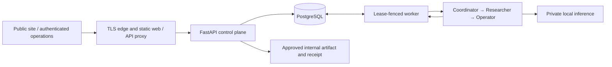

# Architecture and data flow

## State ownership

PostgreSQL owns authentication, memberships, source versions, tasks, attempts, leases, events, approval envelopes, commitments, receipts and episodes. API and worker coordinate through transactional state. Hermes provides three bounded activities rather than a second business scheduler.

The browser never connects to PostgreSQL or the model directly. The workspace route uses example records; authenticated Operations executes business workflows. Five Compose services provide database, model, API, worker and core web; the public website can be released independently while preserving backend services.

## Workflow

1. An authenticated member saves text evidence. Sources have workspace ownership, content hashes and title-based versions; retrieval uses active sources.
2. Task submission includes selected source identifiers, request, client, recipient and the internal account. A workspace-scoped idempotency key deduplicates identical input and rejects reuse with different content.
3. The worker claims work with row locking and a lease. Each attempt has a fencing identity. Stale workers cannot settle another attempt after expiry, cancellation or ownership change.
4. Coordinator, researcher and operator roles run as fresh bounded Hermes subprocesses. Their environment contains required inference settings, with no business credentials. Selected evidence and task context are bounded before invocation.
5. Structured output is validated. Missing evidence, schema failure or runtime limits can block or fail a task; a model's completion statement is insufficient.
6. The person reviews the complete approval artifact: draft, recipient/account, commitments and evidence hashes.
7. The API locks task, approval and current source rows, then checks actor, workspace, task, expiry and content identity. Draft, commitments, receipt, episode and final state commit atomically. That receipt proves an internal transaction, not external delivery.

## Trust boundaries

The API checks origin, CSRF, session and resource membership. Task ownership guards cancellation and approval. The worker proposes work but cannot mint human approval. Inference children receive no database password, session token or external account credential. Browser/shell tools, autonomous skill mutation, external model fallback and general connectors are disabled in the current role path.

Model and database use a private network. API/worker run nonroot and read-only, with dropped capabilities and bounded writable temporary space. Host administration remains a higher-trust boundary: these controls do not protect against a compromised host administrator or provide complete hostile-tenant isolation.

## Configuration and presentation

`src/data/` owns maintained copy and example records; `src/lib/` validates them. Frontend route/environment settings are centralized. Backend application, bootstrap, deployment and child-process settings have separate explicit owners. Credentials stay in private runtime environments and recovery storage, never exported assets.

Events record progression; episodes retain completed summaries. Neither is an externally immutable audit service. Dashboard counts derive from a recent-task list. See [operations](operations.md) for observability and [privacy](privacy-legal.md) for retention implications.
